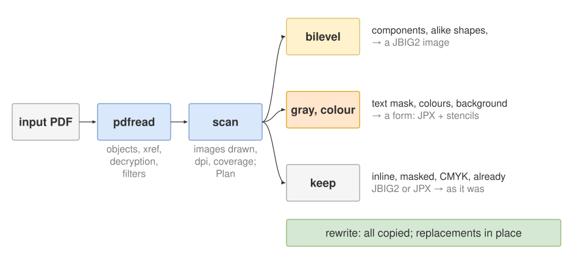
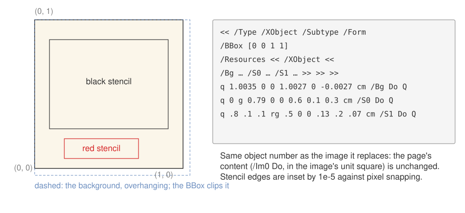

# PDF Rewriting

How dejapdf makes a scanned PDF smaller: what it reads, how it finds the
scan images, how it codes them anew, and what it leaves alone. Numbers in
parentheses are sections of ISO 32000-1:2008 (PDF 1.7),
[PDF32000_2008.pdf](PDF32000_2008.pdf). The coders are those of the DjVu
path: JBIG2 in [JBIG2_Coding.md](JBIG2_Coding.md), JPEG 2000 in
[JPEG_2000_Image_Coding.md](JPEG_2000_Image_Coding.md), and the PDF side in
[Portable_Document_Format.md](Portable_Document_Format.md). A claim marked
*checked* was tested on real scanned books and the test files in
`testdata/pdf`.

A scanned PDF is usually a page-sized image on each page, CCITT G4 for
black and white, JPEG for gray and colour, often with an invisible OCR text
layer over it. Those images are coded far from the best PDF allows: G4 has
no notion of a repeated letter, and JPEG spends most of its bytes on the
edges of the text. dejapdf replaces each such image by what the DjVu path
writes for a page:

| Scan image | Replacement |
|:---|:---|
| bilevel (1 bit) | a JBIG2 image: the letters once in a dictionary, then placed |
| gray, colour | a form XObject: a JPEG 2000 background at about 100 dpi, and the text as JBIG2 stencils in its colours |
| anything else | kept as it is |

Four rules hold throughout:

- **Change only what is re-encoded.** Every other object is copied as it
  is: the text layer, fonts, outline, links, page labels, metadata. A scan
  image is replaced *in place*, under its object number, so the content
  streams that draw it stay untouched.
- **Never grow a file.** A replacement larger than its image is dropped,
  and so is a group of them that would not shrink with its shared
  dictionary. If the whole file comes out no smaller, the command writes
  the input as it was.
- **Keep the letters.** Alike shapes are drawn from one bitmap only when
  they are the same character (§5); `-lossless` keeps every shape exact.
- **JPEG 2000 rather than JPEG** for anything coded anew, and JBIG2 and
  JPX images are copied through: they are compact already.

## 1. Reading the file

`internal/pdfread` reads what real files contain, not only what the
standard allows (7.5):

- cross-reference tables and streams, object streams, `/Prev` chains of
  incremental updates, hybrid files;
- repair: when the cross-reference data is missing or wrong, the file is
  scanned for `N G obj` and the objects are taken from there (the last
  definition wins, as in an update);
- decryption (7.6): RC4 and AES-128 (revisions 2–4) and AES-256
  (revisions 5, 6), with the empty user password. A file that needs a
  password is refused, with the hint to remove it with `qpdf --decrypt`.
  The output is not encrypted;
- the generic filters (7.4): Flate, LZW, ASCII85, ASCIIHex, RunLength,
  with the PNG and TIFF predictors. Decoding stops at an image filter
  (CCITT, DCT, JBIG2, JPX), which `internal/raster` decodes.

Numbers are read as the viewers read them: a sign inside a number ends it,
so `0.5-5` is 0.5, as in Reader, MuPDF and Ghostscript (Poppler skips the
sign and warns). The reader is fuzzed, and opens every one of 1,118 PDFs
in one collection but the 46 that need a password (*checked*).

## 2. Finding the scan images

A page does not say that it is a scan. `internal/scan` finds out by drawing
it, without the pixels: it walks the page's content (`pdfread.Content`)
with the graphics state's matrix, through form XObjects, soft-mask groups
and annotation appearances, and records every image drawn, with the matrix
it is drawn with. From the matrix come the image's resolution and the part
of the crop box it covers. The result is what `pdfimages -list` reports,
plus where each image goes.

Then:

- An image counts toward the scan of its page when it covers at least 5%
  of the page and is not in an annotation or a soft mask.
- A **page is scanned** when such images cover 70% of it together. Two
  half-page images make a scanned page; a figure in a typeset book does
  not.
- A **document is scanned** when half its pages are. A typeset book with a
  scanned cover is not, and is left alone.

`Plan` then decides for each image, with the reason, in this order:

| Case | Decision |
|:---|:---|
| page not scanned, or document not scanned | keep |
| inline image (it has no object to replace) | keep |
| used as another image's mask, or has a `/SMask` or `/Mask` | keep |
| already JBIG2 or JPX | keep |
| CCITT G3 2-D | keep (rare; not decoded) |
| odd bits per component, Lab, Separation, DeviceN | keep |
| bilevel | JBIG2 |
| text drawn over it (not an invisible OCR layer) | keep |
| CMYK | keep (viewers convert it each their own way; §6) |
| gray or colour | separate into layers |

`dejapdf -dump file.pdf` prints this plan by page. A document with no image
to re-encode is refused with the reasons counted ("the scan images are
kept: 408 already jbig2; 1 inline image"), and no output is written.

## 3. Decoding the images

`internal/raster` turns an image into pixels as a viewer would see them:
a bitmap (1 = painted) for bilevel images and stencil masks, or 8-bit
gray, RGB or CMYK. It applies the colour space (Device, ICCBased by its
alternate or component count, Indexed with its palette, CalGray, CalRGB),
`/Decode`, and the polarity of a stencil. The filters it adds to the
generic ones are CCITT (G4, G3 1-D; copied from golang.org/x/image) and
DCT, through `internal/jpeg`: Go's decoder with libjpeg's integer inverse
DCT, upsampling and YCbCr rounding, so that the pixels are libjpeg's. The
output equals `pdfimages -png` (`-tiff` for CMYK) on every scanned book
(*checked*).

A bilevel image also records which raw sample value is ink, as the
`/Decode` its replacement needs (§4).

## 4. Bilevel scans: JBIG2

The bitmap is split into 8-connected components (`internal/shapes`): runs
of each row joined by union-find, each component cut out as a shape, exact
duplicates merged, components over 1024 pixels on a side tiled. That is a
`jb2.Image`, the same structure the DjVu path decodes from JB2, and
`internal/stencil` codes it the same way: a symbol dictionary, a text
region that places the symbols, and refinements (JBIG2_Coding.md §8–§10).

Images are coded in **groups of 32**. Shapes used by more than one image of
a group go into a dictionary they share, written once as the group's
`/JBIG2Globals` stream; each image keeps its own dictionary for the rest.
The replacement keeps the image's dictionary, with the filter, bits per
component and `/Decode` changed: JBIG2 decodes ink as sample 0, so an
image whose ink was sample 1 gets `/Decode [1 0]` (*checked*: the drawn
image is the same).

**Alike shapes.** `shapes.Classify` groups shapes that are the same
character printed twice: sizes within 2 pixels (1 up to 24 pixels, none
for marks up to 10 and for narrow shapes like l, I, 1), the same number of
holes, each within one pixel of the other with centroids aligned, a
weighted XOR below the perimeter, and no thick patch of XOR (a serif, the
tail of a Q, the flag of a 1). Each shape joins its best earlier
representative. The rules were tuned on `testdata/pdf/digits.pdf`: rows of
look-alike characters (0O, 1lI, 6b, 8B, 5S, c e o, comma and period) in
four fonts and three scan qualities. Its test reads every glyph by
template matching before and after; no character changes (*checked*).

By default each member of a class is drawn from its representative's
bitmap: a book of 527 pages at 300 dpi becomes 5× smaller than its G4 scan.
With `-lossless`, a member of the same size is coded as a refinement of the
representative instead, and every image decodes in `jbig2dec` to the
original bitmap bit for bit (*checked*); the same book is then 1.66×
smaller. A refinement must keep its reference's size and position: Adobe
Reader fails on anything else (JBIG2_Coding.md §8).

**One gray level.** MuPDF averages an image's samples before `/Decode`
when it subsamples, so an image with `/Decode [1 0]` renders one gray
level off at reduced zoom, from 1:2 down; at full resolution it is exact.

## 5. Gray and colour scans: layers

A gray or colour scan is split like a DjVu page (`internal/segment`): the
text, sharp, in a few colours; the rest, the paper and the pictures, as a
smooth image at low resolution.

**The text mask.** `Mask` thresholds a gray version of the scan:

- The gray is the luminance, darkened where a pixel's darkest channel
  falls further below the paper's than its luminance does: bright coloured
  ink (green, yellow) stands out from white paper as dark ink does, and
  nothing changes for ink of a coloured paper's own hue.
- A faded page, whose darkest 0.5% of pixels is within 160 levels of the
  paper, is stretched to the full range for the threshold only. Sauvola's
  threshold is tuned for full contrast, and on a faded page would keep only
  the cores of the strokes.
- Sauvola's threshold (k = 0.34, R = 128) over a window of 1/6 inch, and
  anything darker than half the paper: thick strokes wider than the window.
  Holes darker than halfway between ink and paper are filled.

Then marks that are not text are dropped, to the background: specks; marks
less than 30 levels darker than the paper of their quarter-inch tile;
photographs (tiles whose paper is dark, or with mid-tones away from the
ink, joined into regions and taken by their boxes); thick blobs over a
square inch (shadows, page edges); and halftones and textures, by
Bloomberg's halftone mask (Leptonica's method, written anew). Small marks
near the edge of a picture's box, on clean paper, stay: captions.

**The colours.** `Colors` gives each mark a colour. Its lightness is the
mean of its pixels from the 25th to the 50th percentile: the lighter half
is the edge, mixed with the paper, and the darkest quarter is noise. Its
hue is taken from the mark and the two pixels around it, summed against
the paper around: JPEG halves the chroma resolution and so spreads the
colour of a thin stroke beyond it, but blurring keeps the sum. Near-black
marks are black; the rest form a palette of up to 8 colours by k-means
weighted by area, centres closer than 40 merged, and each mark takes the
nearest colour, black included, so that a line of text is one colour. On a
faded page, near-neutral ink lighter than a third of the paper's luminance
is darkened to it; saturated colours stay as printed.

**The background.** `Background` reduces the scan to about 100 dpi (by
the factor nearest to dpi/100) and fills what the text covered, so that
the text leaves no ghost and the wavelets spend nothing on it:

Pixels within r0 = dpi/100 of the mask are the blurred edge of the ink and
are left out. Those out to r1 = dpi/20 hold JPEG's ringing around the
letters: they count less the nearer they are, and not at all if darker by
6 levels than the paper beyond r1 (itself filled first, from the far pixels
only). Distance alone was not enough: text rows stayed 4–5 levels darker
than the paper between them (*checked*). A cell left with no weight is
filled by push-pull: a pyramid of weighted means, each level filling the
holes of the one below by bilinear interpolation. Leptonica fills its
background maps by replicating columns, which is enough for its use, a
lighting estimate, but would leave streaks in an image to be compressed.

The filled background is coded as JPX with PCRD-opt cut at a **slope**:
a coding pass is kept only if it removes at least 100 of squared error (in
8-bit levels, summed over the samples) per byte. The grain of the paper
then costs nothing, while a faint feature, a pencil mark or a gray box,
removes much error for few bytes and stays (*checked*: a box 12 levels
darker than paper with grain survives exactly, at 334 bytes for 256 × 256
against 24 KB with every pass). A target on the error of the whole page
would erase such a feature instead. The size is capped at `-q` times the
original image (0.15 by default), which only photographs reach. A
background that is one colour within ±2 becomes a fill.

**The form.** The replacement is a form XObject in the image's place:

Its `/BBox` is the unit square, which is where the page draws the image,
so the content stream that drew the image draws the form unchanged. The
background fills the square; reduced by k and rounded up, it may overhang
the right and bottom edges by less than k pixels, and the bounding box
clips that. Then one stencil per palette colour, each cropped to its marks
and inset by 10⁻⁵ of the square on every side: viewers snap image edges to
device pixels, and an edge exactly on a pixel boundary may snap either way
(Portable_Document_Format.md §8). The stencils of a group of 32 images
share a `/JBIG2Globals`, as in §4. An image's optional-content `/OC` moves
to the form.

**CMYK is kept.** Viewers convert CMYK to RGB each their own way, with
their own approximations of a press profile; a replacement in RGB fixes one
conversion, which on a test page made green text visibly duller than every
viewer shows the original (*checked*). Scans in CMYK are rare.

**Limits.** Light text on a dark or coloured ground (white titles on a red
cover) stays in the background, at its lower resolution; so does text on
cloth or other texture. Stroke weight grows a little: 4% more ink at 241
dpi, 20% on 96 dpi scans. Photographs of open books keep the shadows of
page edges as thin lines in the mask.

## 6. Writing the file

`internal/rewrite` writes the document anew through dejapdf's PDF writer:
the objects reachable from the catalog and the document information,
renumbered, the non-stream objects packed into object streams, with a
cross-reference stream. Streams keep their encoded data as they were,
reals are written with all their digits, and a header version above 1.5
goes into the catalog's `/Version`. Dictionary keys are visited in sorted
order, so the numbering, and the file, are the same on every run.
`Replace` writes the new streams in place of the old objects, and adds the
shared dictionaries as new objects.

With `-p`, `Select` keeps only the pages given, in that order: a page tree
of one level, each page with the attributes it inherited (resources, media
and crop box, rotation) copied in, and references to the other pages,
from bookmarks, links or named destinations, made null. Page labels are
dropped, as they count pages by position. Only the kept pages' images are
re-encoded.

## 7. What stays untouched

Everything but the scan images: content streams, the text layer with its
fonts (so text selects over the same words: `pdftotext -bbox` gives the
same output before and after, *checked*), annotations, outline,
destinations, page labels, metadata, structure tree, embedded files. Unused
objects, unreachable from the catalog, are not copied; encryption is
removed.

## 8. Checking it

The test oracles are run, never linked:

| Check | How |
|:---|:---|
| every JBIG2 image decodes | `jbig2dec`; lossless: equal to the original bitmap; lossy: no pixel more than 2 away |
| every JPX background decodes | `opj_decompress` |
| the file is sound | `qpdf --check` |
| nothing else changed | the object graphs of input and output compared: equal but for numbering and the replaced images; streams byte for byte |
| layers look right | MuPDF renders, and Adobe Reader 9 prints, each page with layers within 26 dB of the original, blurred over 3 × 3 pixels at 50 dpi (stroke weight may differ, placement and colours may not) |
| bilevel pages look the same | Reader 9 prints them identically |
| by eye | MuPDF, Poppler, pdf.js, Ghostscript, Acrobat 26 |

On 40 scanned PDFs of one collection, 30 distinct books were re-encoded
and 6 refused (their scans already JBIG2 or JPX, or text drawn over them):
1.1 GB became 200 MB, 5.5×. Bilevel books in G4 became 1.2–12× smaller,
gray JPEG scans 4–15×, colour ones 4–57×; books already in JBIG2 gained
little. No file grew, and every output passed `qpdf --check` (README).
